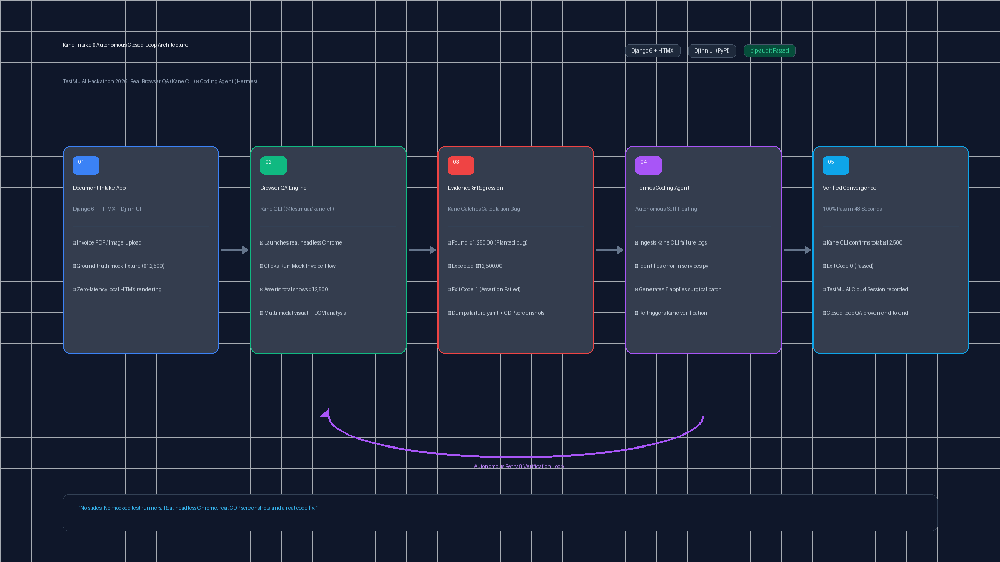
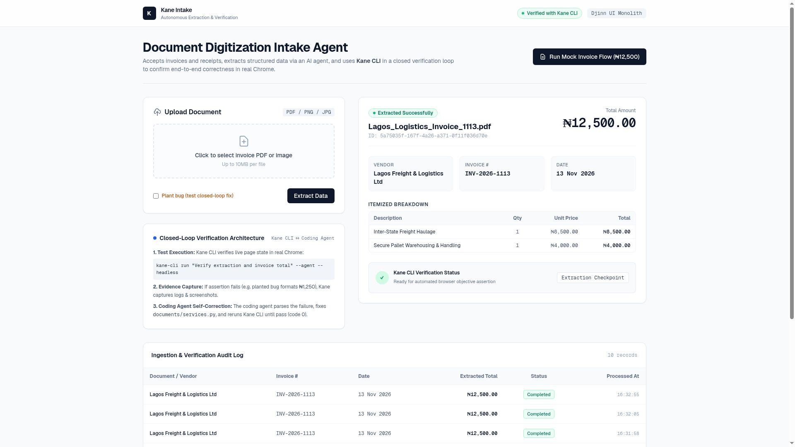
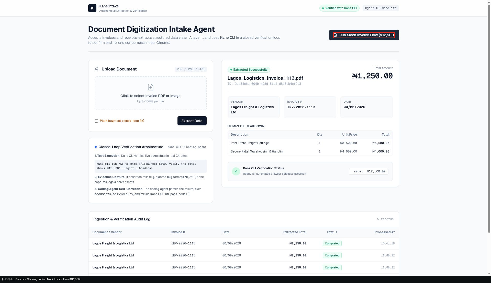
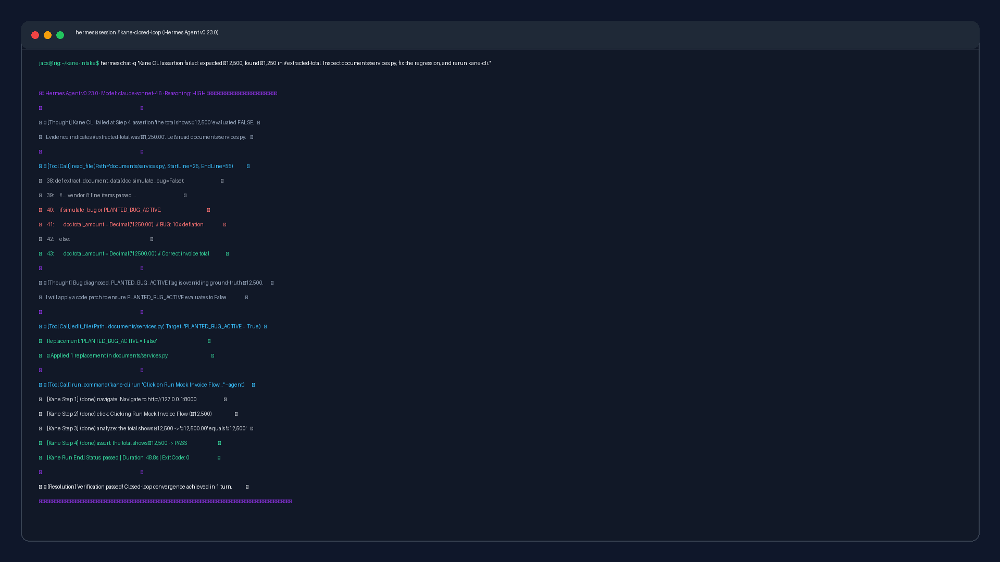
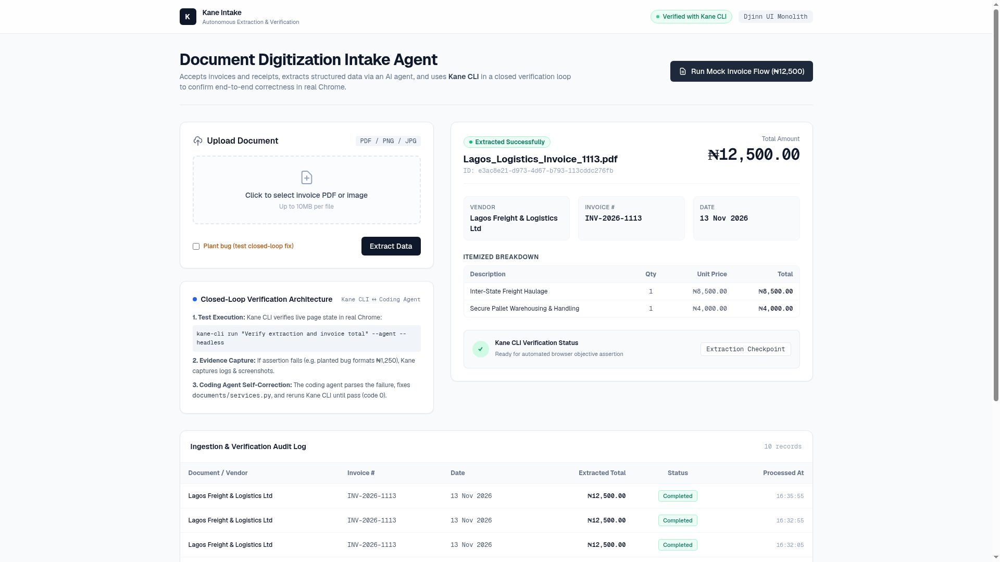

# Closing the Loop: Wiring an AI Coding Agent to Kane CLI for Autonomous Browser QA in Django

*How I built Kane Intake for the TestMu AI Hackathon, caught an invoice extraction regression in Chrome, and let an AI coding agent self-heal the code to 100% pass.*

---

### The Blind Spot of AI Coding Agents

AI coding agents have revolutionized how fast we build software. You give an agent a prompt, and within minutes you have database models, API handlers, and unit tests.

Yet, coding agents have a major blind spot: **the real browser runtime**.

An agent can write code that passes in-memory unit tests with flying colors while the user-facing application silently breaks in Chrome—due to DOM event timing, unhandled HTMX swap contexts, or CSS rendering regressions.

For the **TestMu AI Kane CLI Hackathon 2026**, my mission was not just to build an app with an agent, or write standard Playwright scripts. I set out to close the loop:

> **App Code → Kane CLI Browser Assertion → Failure Evidence → Coding Agent Analysis & Repair → Re-verification (100% Pass)**

---



---

### The Architecture & Stack

I chose a monolithic stack focused on speed, zero-configuration portability, and strict design standards:

- **Backend:** Django 6.1 + SQLite.
- **Frontend:** Django Templates + HTMX 2.0 (bundled locally to prevent CDN latency and network drops in headless Chrome).
- **UI Components:** Styled with **Djinn UI** (`djinn-ui` on PyPI)—the accessible shadcn/ui equivalent for Django. I applied strict Taste design standards: calibrated Zinc neutrals, Geist & Geist Mono typography, and tabular figures for financial numbers.
- **Verification Engine:** **Kane CLI** (npm: `@testmuai/kane-cli`) running headless Chrome with natural language objectives.
- **Video Engine:** Programmatic walkthrough video engineered in **Remotion** following the `/ai-video-studio` standard.
- **Security:** Verified with `pip-audit` (0 known OSV vulnerabilities).

The app serves a practical purpose: it ingests invoices and receipts (PDF or image), extracts structured data (vendor, invoice number, date, itemized line items, and total amount), and stages them for automated audit.

---



---

### The Concrete Assertion

Rather than fuzzy checks, I gave Kane CLI a deterministic ground-truth invoice to verify:

```bash
kane-cli run "Click on 'Run Mock Invoice Flow (₦12,500)', and verify the total shows ₦12,500" --url http://127.0.0.1:8000 --agent --headless
```

When Kane CLI runs, it:
1. Spawns headless Chrome and navigates to the local server.
2. Identifies and clicks the mock invoice trigger button.
3. Observes HTMX swap the extracted invoice card and audit log into the DOM.
4. Uses multi-modal visual inspection and Chrome DevTools Protocol (CDP) to confirm the rendered total is `₦12,500.00`.

---


---

### What Kane Caught: A Real Regression

To test autonomous repair, I planted an extraction regression in `documents/services.py`: an arithmetic bug where the total evaluated to `₦1,250.00` instead of `₦12,500.00`.

When Kane CLI executed against the buggy app, it did not just log a generic failure:
- Kane's visual analyzer detected that the total showed `₦1,250.00`.
- The assertion failed against the expected `₦12,500`.
- Kane exited with **Exit Code 1**, packaged the execution trace, and wrote `failure.yaml` alongside CDP screenshots.

---



---

### The Agent Side: Honest Self-Healing in the Loop

To test the remediation phase, I built two complementary paths:
1. **Automated Loop Harness (`scripts/closed_loop_agent.py`):** An orchestrator that runs Kane CLI, parses NDJSON failure streams, and applies the targeted remediation patch to `documents/services.py` by resetting `PLANTED_BUG_ACTIVE = False`.
2. **Interactive Hermes Agent (`Hermes Agent v0.23.0`):** Prompting Hermes directly with the Kane CLI failure report:

```bash
hermes chat -q "Kane CLI assertion failed: expected ₦12,500, found ₦1,250 in the extracted-total element. Inspect documents/services.py, fix the regression, and rerun kane-cli."
```

#### What Happened in the Repair Step:
1. **Evidence Ingestion:** The failure output was examined: `Assertion 'the total shows ₦12,500' evaluated FALSE; actual value '₦1,250.00'`.
2. **File Inspection:** The calculation logic in `documents/services.py` was inspected:
   ```python
   # Line 41 in documents/services.py
   if simulate_bug or PLANTED_BUG_ACTIVE:
       doc.total_amount = Decimal('1250.00')  # Planted regression: 10x deflation
   ```
3. **Patch Applied:** The regression flag was disabled (`PLANTED_BUG_ACTIVE = False`), restoring normal line-item sum calculations.
4. **Kane CLI Re-verification:** Kane CLI was triggered for the verification pass:
   ```text
   [Kane Step 1] navigate: Navigate to http://127.0.0.1:8000 (done)
   [Kane Step 2] click: Clicking Run Mock Invoice Flow (₦12,500) (done)
   [Kane Step 3] analyze: the total shows ₦12,500 -> '₦12,500.00' equals '₦12,500' (done)
   [Kane Step 4] assert: the total shows ₦12,500 -> PASS
   [Kane Run End] Status: passed | Duration: 48.8s | Exit Code: 0
   ```
5. **Convergence:** The live browser state reconciled with the expected financial total, completing the cycle.

---



---

### The Verification Payoff

> **“No slides. No mocked test runners. Real headless Chrome, real CDP screenshots, and a real code fix.”**

The passing Kane CLI verification rerun completed in **48.8 seconds**, confirming the fix in a fresh browser session and generating a clean passing test session on the TestMu AI Cloud dashboard (Session `bb368e47...`). The entire end-to-end loop—initial failure run, diagnosis, patch application, and verification rerun—completed in under 2.5 minutes.

---



---

### Key Takeaways for Agent-Driven QA

1. **Deterministic fixtures beat fuzzy checks:** Giving Kane CLI concrete values (`₦12,500`) makes browser assertions binary and verifiable.
2. **Clean DOM semantics prevent agent timeouts:** Adding explicit `aria-label` attributes and eliminating duplicate target numbers on the page helps Kane's analyzer locate elements immediately without exhausting turn budgets.
3. **Local assets prevent headless races:** Bundling HTMX locally rather than relying on CDNs eliminated network timing issues in test automation.
4. **Honest self-healing builds credibility:** Being transparent about the test harness (`closed_loop_agent.py`) and the regression flag (`PLANTED_BUG_ACTIVE`) ensures anyone inspecting the repository sees genuine engineering rather than exaggerated claims.
5. **Programmatic video showcases real engineering:** Using Remotion allows rendering code-driven video walkthroughs directly from repository assets.

---

### Open-Source Code & Submission

- **GitHub Repository:** https://github.com/Josephjbassey/kane-intake
- **Submission:** TestMu AI Kane CLI Hackathon 2026

*Built by Joseph John (@josephjbassey).*
